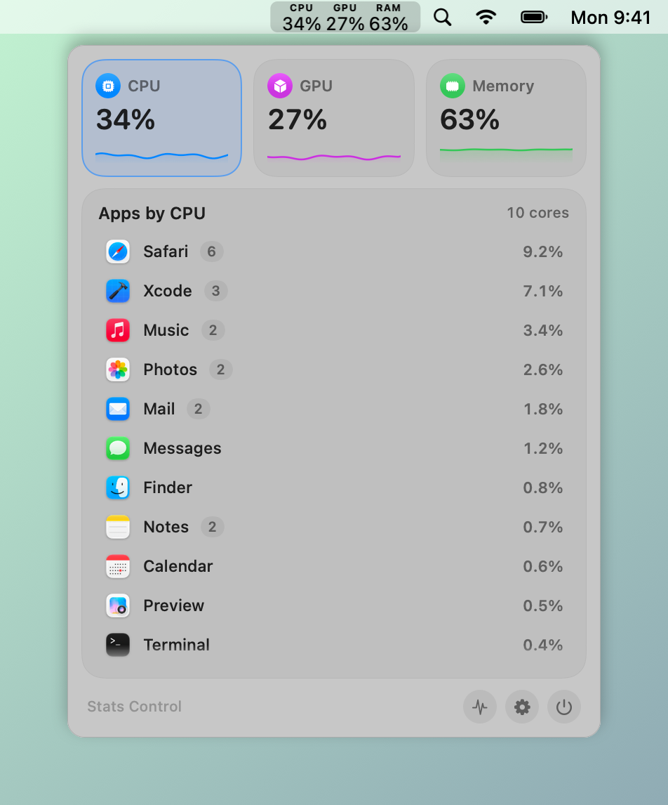
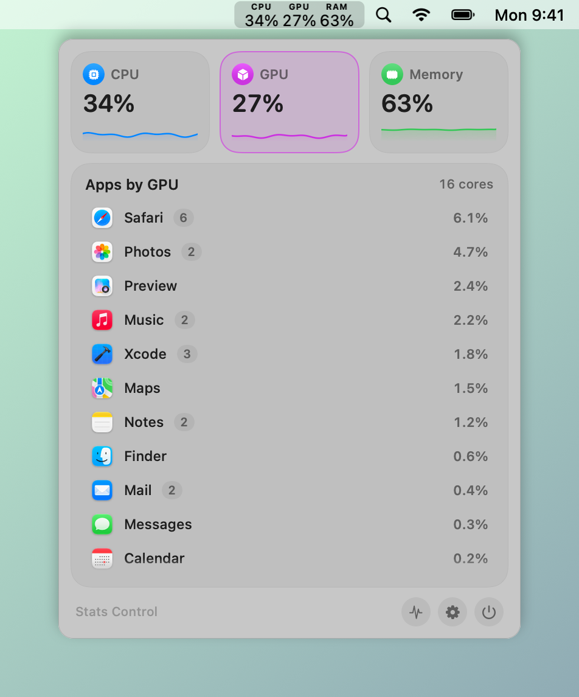
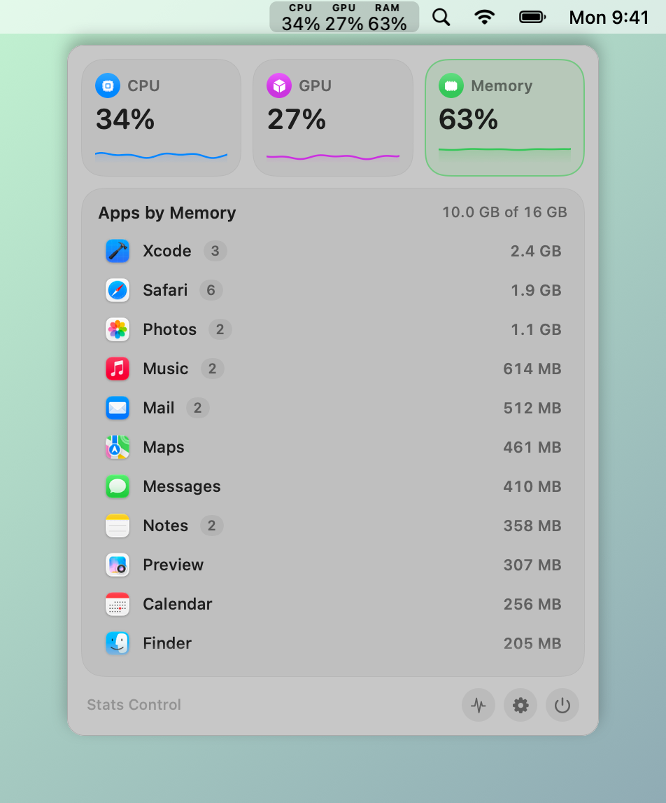
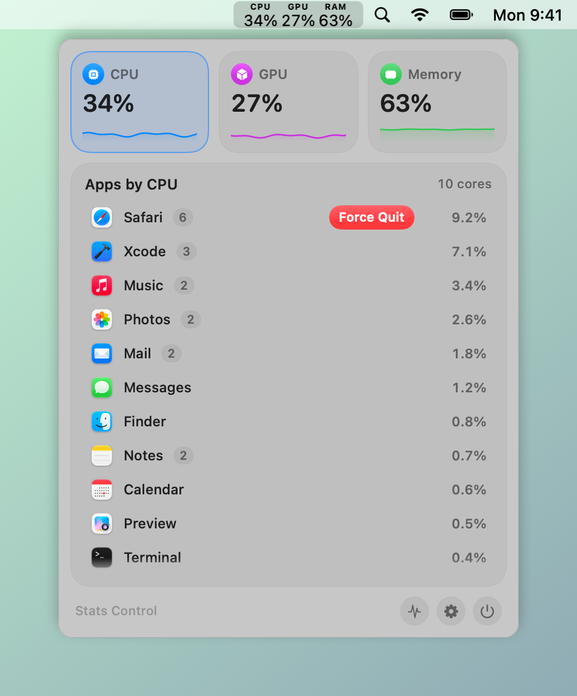
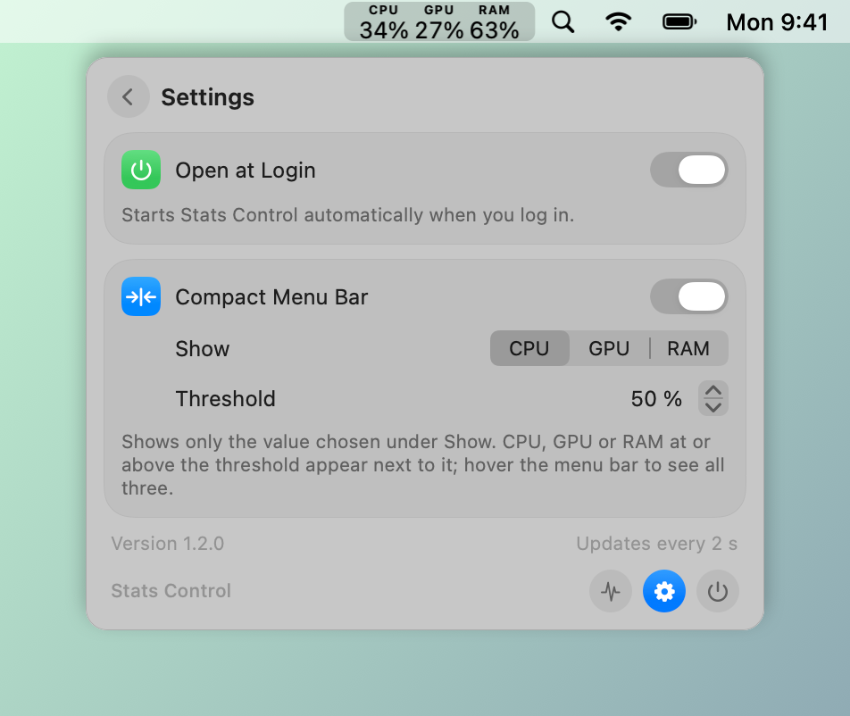

# Stats Control

[](#requirements)
[](docs/DEVELOPMENT.md)
[](LICENSE)
[](#ai-assisted-development)

A lightweight menu bar monitor for macOS: CPU, GPU and memory at a glance, with a process list you can quit from.

<picture>
  <source media="(prefers-color-scheme: dark)" srcset="docs/images/main-dark.png">
  
</picture>

> [!NOTE]
> This app was developed with AI assistance. See [AI-assisted development](#ai-assisted-development).

## Features

- **Live menu bar**: CPU, GPU and RAM as three narrow percentage columns in the clock's font.
- **Compact mode**: show just one metric; the others slide in only when they cross a threshold you choose.
- **Process list**: apps sorted by CPU, GPU or memory, helper processes grouped under their app, 2-minute history per metric.
- **Quit from the menu**: click twice to force-quit, or right-click for a normal quit. System processes are protected.
- **Light on resources**: no network, no telemetry, about 13 ms per measurement, refreshes slowly while the menu is closed.

## Screenshots

<table>
  <tr>
    <td align="center"><br>GPU list</td>
    <td align="center"><br>Memory list</td>
  </tr>
  <tr>
    <td align="center"><br>Quit confirmation (second click force-quits)</td>
    <td align="center"><br>Settings with compact menu bar</td>
  </tr>
</table>

## Requirements

- macOS 26 or later on Apple silicon

## Installation

1. Download `StatsControl-<version>.zip` from the [latest release](../../releases/latest) and unzip it.
2. Move **Stats Control.app** to `/Applications`.
3. Open it. The app is free and ad-hoc signed, not notarized by Apple, so macOS blocks the first launch:
   open **System Settings → Privacy & Security**, scroll down and click **Open Anyway**.
   Alternatively, in Terminal: `xattr -dr com.apple.quarantine /Applications/StatsControl.app`

The app starts at login by default; switch this off under Settings (gear icon) → **Open at Login**.
To uninstall, quit it from the menu and move it to the Trash.

## Usage

- Click the menu bar item to open the menu. Click a tile (CPU, GPU, Memory) to sort the list by it.
- Hover a row and click the quit button twice to force-quit; right-click a row for **Quit** or **Force Quit**.
- The activity icon in the footer opens Activity Monitor.

## Build from source

```sh
brew install xcodegen
git clone https://github.com/ape97/StatsControl.git && cd StatsControl
./scripts/check.sh    # build + snapshots + self-test -> RESULT: GREEN
./scripts/deploy.sh   # check, install to /Applications, restart
```

No Apple developer account is needed. Project layout, scripts, signing, screenshots and releases are described in
[docs/DEVELOPMENT.md](docs/DEVELOPMENT.md).

## Permissions and privacy

Stats Control needs no special permissions. It reads process statistics of the current user with `proc_pid_rusage` and
other processes through `ps`, and it can only quit processes of the current user. Everything stays on your Mac:
no network access, no telemetry. The only stored data are your settings in the app's user defaults.

## AI-assisted development

Stats Control was built with the help of an AI coding assistant: code, comments, documentation and the screenshot
pipeline were written in collaboration with AI. Every change is built and checked with `scripts/check.sh`
(warning-free build, snapshots, self-test) and the app is in daily use on the maintainer's Mac.
Issues and pull requests are welcome.

## License

MIT, see [LICENSE](LICENSE).
